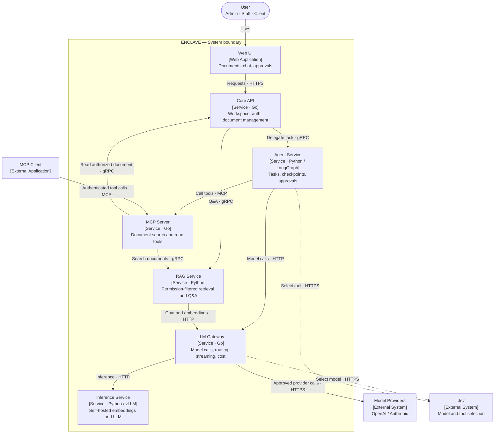
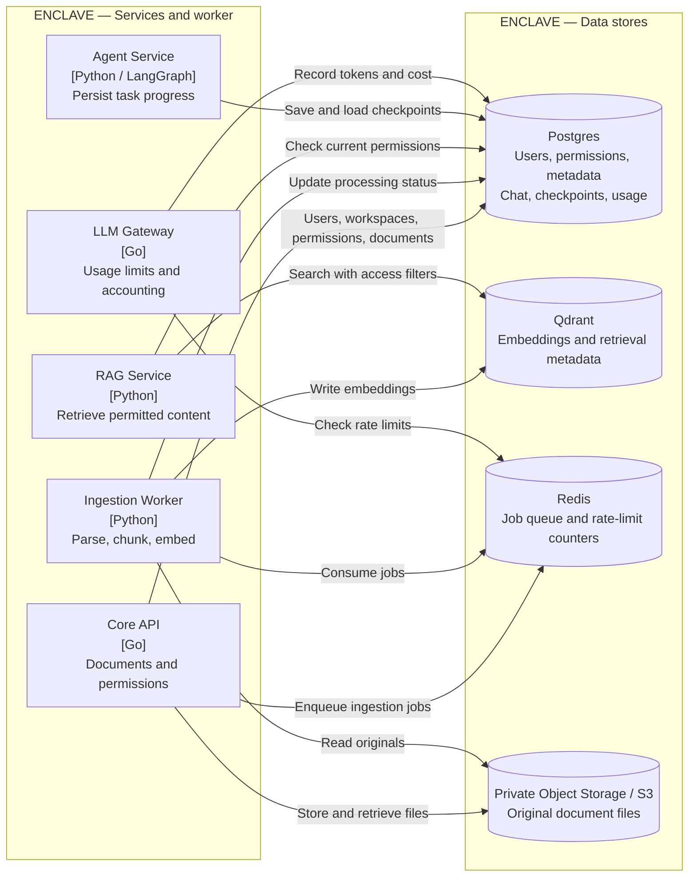
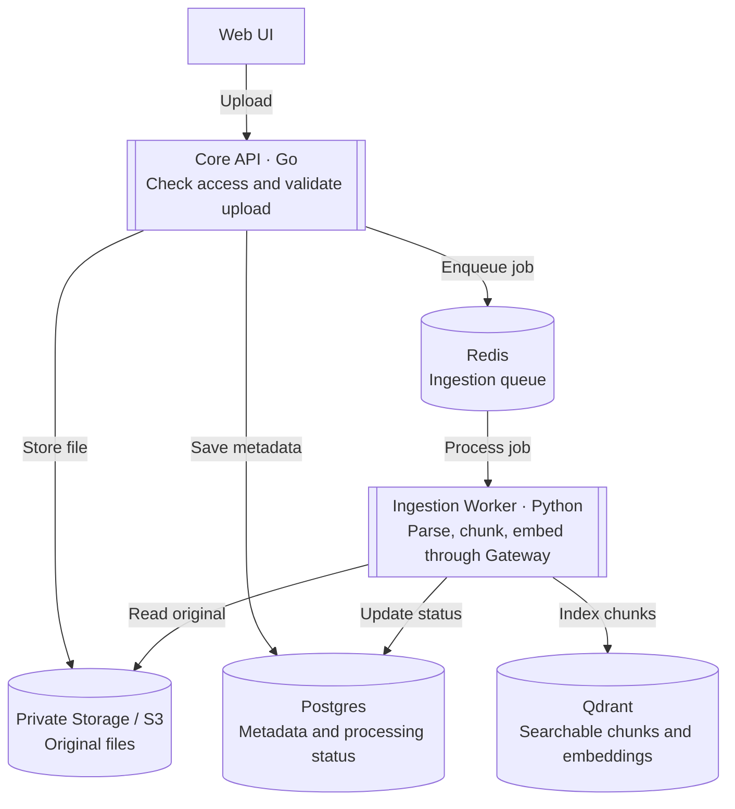
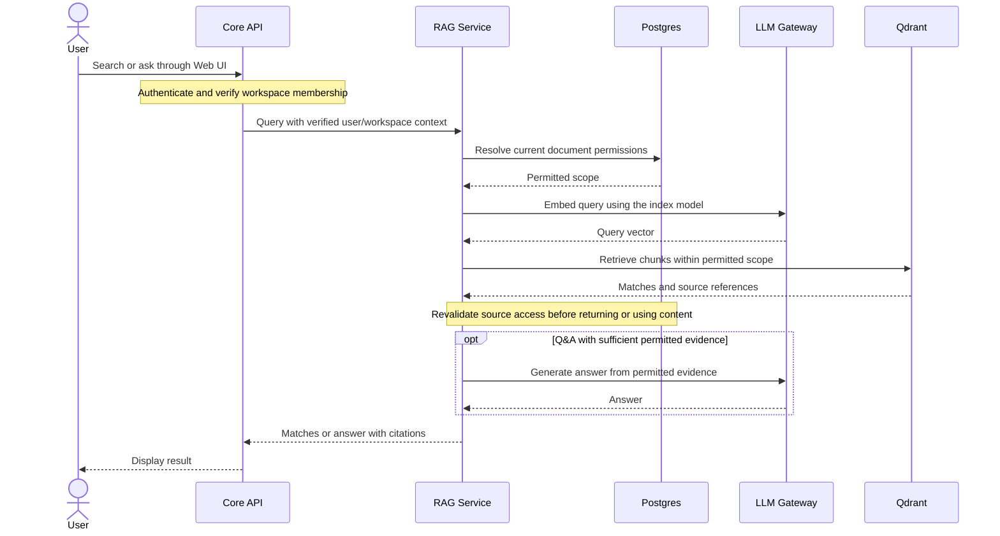

# Enclave: Private Document Workspace

## 1. What we are building

A shared document workspace that any business can use for its own knowledge base. Staff manage documents, and staff or clients ask questions and receive answers with source citations.

Each business has a separate workspace. Users only see documents they are allowed to access.

Examples:

- Staff: "What is our internal onboarding process?"
- Client: "What does your support policy cover?"

Version 1.0 includes document storage, access control, Q&A, MCP tools, and an agent, built with the original tech stack. E2EE and encrypted search come after version 1.0 is complete. The application processes readable content; external AI providers may receive authorized excerpts only when enabled by the workspace admin.

## 2. Users and document access

Roles belong to a workspace, not to a user globally.

| Role | Permissions |
|---|---|
| Admin | Manage workspace, members, roles, AI settings, and all documents |
| Staff | Upload and manage documents; read internal and client-common documents |
| Client | Read and ask questions about client-common documents only |

| Document visibility | Who can access it? |
|---|---|
| Internal | Admin and staff in the same workspace |
| Client-common | Admin, staff, and all authenticated clients in the same workspace |

Rules:

- New documents are internal by default. Staff or admins explicitly share them with clients.
- Client-common does not mean public on the internet or shared across businesses.
- Check workspace membership and document access on every list, search, read, download, and write request. Deny access unless explicitly allowed.
- Filter retrieval by permissions before sending content to the model. The model never decides access rights.
- Apply access checks to citations and conversation history too. Recheck access on each turn and block stored answers whose source access has been revoked.
- Document content is untrusted input, never an instruction to change permissions.

## 3. Tech stack and architecture

| Component | Technology |
|---|---|
| Core API, LLM Gateway, MCP server | Go, separate services |
| RAG pipeline | Python, docling or unstructured, Ragas |
| Agent and decision routing | Python, LangGraph, Jev (optional, integrated after a working baseline) |
| Self-hosted inference | Python, vLLM; Ollama for local development |
| Data | Postgres for application data; Qdrant for embeddings and vector search |
| Rate limiting and background jobs | Redis |
| Internal service contracts | gRPC / Protobuf; MCP for agent tools |
| Local development and CI | Docker Compose, GitHub Actions |
| Cloud | Terraform, AWS S3, RDS, ECS Fargate, ElastiCache |
| Observability | OpenTelemetry, Prometheus, Grafana |
| Optional search exercise | Rust HNSW; E2EE/ORAM after v1.0 |

```text
Web UI -> Core API (Go)
            -> RAG (Python)                    [direct Q&A]
            -> Agent (Python, LangGraph)       [multi-step tasks]
                 -> MCP server (Go) -> RAG

RAG -> Qdrant: embeddings and permission-filtered vector search
RAG + Agent -> LLM Gateway (Go)
                 -> OpenAI / Anthropic / Ollama
                 -> Inference service (Python, vLLM)
```

The Core API handles workspace identity, authorization, and document management. Every downstream service enforces the same access scope using server-verified identity. Keep internal services private. A small web UI supports uploads, sharing, chat, and approvals.

See [Architecture diagrams](#8-architecture-diagrams) for the C4 views and two main flows: upload and search/Q&A.

## 4. Build one part at a time

Each part follows the previous one. Build, verify, and write a short note in `docs/learnings/`. Use sample documents while developing. Finish the required work before trying stretch goals.

Keep this plan at overview level. Detail the supporting flows and error cases listed under each part only when implementing that part. Add a separate diagram then if it helps; do not design every flow upfront.

### Part 0: Foundation

**Build:** Monorepo folders for `api`, `gateway`, `mcp`, `rag`, `agent`, `inference`, `proto`, `infra`, and the web UI. Start Postgres, Redis, and Qdrant through Docker Compose. Add migrations, GitHub Actions, and `make up/test/proto`.

**Learn:** Polyglot project structure, gRPC, Protobuf, and local infrastructure.

**Done when:**

- [ ] One command starts local infrastructure, and a Go service can call a Python service through gRPC.
- [ ] CI runs linting and tests for Go and Python.

### Part 1: Workspace and access control

**Build:** Login/logout, workspaces, member invitations, and admin/staff/client roles in the Go Core API. Add a basic member-management screen and authorization checks.

**Learn:** Sessions, authentication vs. authorization, RBAC, and tenant isolation.

**Done when:**

- [ ] An admin can invite members and change or revoke their roles.
- [ ] Tests reject unauthorized operations and cross-workspace access, including guessed IDs.

**Detail when implementing:**

- Login/logout, invitation acceptance, and workspace selection.
- Role changes and membership revocation, including existing sessions.

### Part 2: Document library

**Build:** Upload, list, preview/download, delete, and change visibility for PDF, Markdown, and DOCX. Store originals privately, validate uploads, and show document processing status.

**Learn:** File storage, metadata, access checks, and document lifecycle.

**Done when:**

- [ ] Staff can upload an internal document and explicitly share it with clients.
- [ ] Clients can access client-common documents only. Deleting or unsharing a document blocks affected access immediately.

**Detail when implementing:**

- List, preview, download, and opening citations: check current access before reading the private file.
- Share/unshare and delete: block affected access first, then synchronize metadata and clean up files/vectors.

### Part 3: LLM Gateway (Go)

**Build:** A separate gateway with an OpenAI-compatible chat API, an embeddings API, SSE streaming, and adapters for OpenAI, Anthropic, and Ollama according to their supported capabilities. Add Redis rate limiting and token/cost accounting in Postgres.

Allow fallback only to workspace-approved providers and before streaming output begins. Keep secrets on the server and document text/questions out of logs.

**Learn:** Go concurrency, cancellation, streaming, provider differences, and rate limits.

**Done when:**

- [ ] At least two providers stream through the gateway; embeddings work through a supported provider.
- [ ] Test timeout, cancellation, and approved fallback; record gateway latency with k6.

Start with simple routing rules and record their performance. Optional Jev integration comes in Part 8, after the agent also works without it.

**Detail when implementing:**

- Rate-limit rejection, provider timeout, approved fallback, mid-stream failure, and client cancellation.
- Token/cost accounting across successful, failed, and retried calls.

**Stretch:** Circuit breakers and permission-aware caching.

### Part 4: RAG and Q&A (Python)

**Build:** Parse documents with docling or unstructured, chunk them, and generate embeddings through the gateway. Use a Redis-backed ingestion queue. Store embeddings in Qdrant and apply workspace/access filters during retrieval. Keep users, permissions, and document metadata in Postgres. Add chat with page/section citations.

Filter documents by current permissions before model calls. Track embedding model/version and re-embed when changing models. Keep conversation history private to its owner and enforce source access on later turns.

**Learn:** Embeddings, retrieval, background jobs, citations, and RAG evaluation with Ragas.

**Done when:**

- [ ] Staff and clients get grounded answers from permitted documents, or an explicit “not enough information” response.
- [ ] A 30–50 question evaluation covers answer quality, citations, unanswerable questions, and permission boundaries.
- [ ] Measure retrieval quality and latency on a fixed dataset; verify retries do not duplicate chunks or resurrect deleted documents.

**Detail when implementing:**

- Ingestion failure/retry and partial writes; keep retries safe after deletion.
- Empty results, stale permissions, citation access, and history after access is revoked.
- Chunk text/citation storage, embedding version changes, and re-indexing.

**Stretch:** Hybrid search, reranking, OCR, and chunking experiments.

### Part 5: Inference service (Python, vLLM)

**Build:** Serve an embedding model and a small LLM with vLLM, and register them in the gateway. Use Ollama for everyday local development and a GPU environment for serving experiments.

**Learn:** Model serving, batching, KV cache, quantization, and operating costs.

**Done when:**

- [ ] Q&A works with self-hosted embeddings and generation through the gateway.
- [ ] Record quality, latency, throughput, and cost against an API baseline.

### Part 6: MCP server (Go)

**Build:** Use the official Go SDK to expose `search_documents` and `get_document`. Authenticate each caller and apply the same workspace/document permissions as the web app. Connect an approved MCP client for a demo.

**Learn:** MCP tools and transports, identity propagation, and least privilege.

**Done when:**

- [ ] An MCP client answers questions using permitted documents.
- [ ] Internal documents remain inaccessible to client accounts, including direct tool calls. External MCP clients are used only under the workspace's data-sharing policy.

**Detail when implementing:**

- MCP client authentication and verified identity propagation to tools.
- Reuse the web search/read access rules; handle revoked access and tool errors.

### Part 7: Agent (Python, LangGraph)

**Build:** An agent that searches documents, compares information, and drafts a response using MCP tools and gateway models. Add Postgres checkpoints, step/cost limits, and a UI for approvals. Code policies determine which actions require approval; bind approval to the exact action and inputs. Recheck permissions after resumption.

**Learn:** Graph workflows, durable execution, idempotency, and human approval.

**Done when:**

- [ ] Demo “Find the relevant policies, summarize the differences, and prepare a response for review” under the caller's permissions.
- [ ] Restarting a task resumes safely; a persisted action is not duplicated and changed inputs require fresh approval.

Save a fixed evaluation set and baseline results without Jev: task success, answer quality, latency, model calls, and total cost. Keep this version runnable for comparison.

**Detail when implementing:**

- Task execution, approval/rejection, changed inputs, and cancellation.
- Crash/resume, duplicate-action prevention, permission rechecks, and exhausted limits.

### Part 8 (optional): Integrate and evaluate Jev

**Goal:** Learn Jev through a real integration and measure what changes. This part is optional and does not block v1.0; do it if Jev access is available when you get here, otherwise skip it.

**Build:** Check Jev access and its API contract when starting this part, then add a switchable decision layer. First use Jev to choose between workspace-approved models; evaluate that change before adding tool selection from the caller's permitted tools. Keep the existing decision path as a fallback for errors or low confidence.

Only send context permitted by the workspace's data-sharing policy. Authorization, mandatory approvals, and step/cost limits remain enforced by code.

**Learn:** Typed decisions, confidence thresholds, fallback behavior, and controlled comparisons.

**Done when:**

- [ ] The same workflow runs with Jev off and on. Test provider failure and fallback as well as successful decisions.
- [ ] Compare baseline, Jev model routing, and Jev routing plus tool selection on the same held-out tasks, documents, permissions, and model versions. Tune on separate examples and repeat runs to capture variation.
- [ ] Record task success, answer quality, latency, strong-model calls, fallback rate, and total cost including Jev and retries. Explain where Jev helps, adds overhead, or makes results worse; improvements are not assumed.

**Detail when implementing:**

- Baseline/Jev switching, low-confidence decisions, provider errors, and fallback.
- Validate selected models/tools against allowed choices and record comparable before/after runs.

### Part 9: Deploy and finish v1.0

**Build:** Terraform for private S3 storage, RDS, ECS Fargate services, and ElastiCache. Specify persistent storage/backups for Qdrant and separate GPU compute for vLLM. Add CI/CD, HTTPS, secrets, audit events, OpenTelemetry traces, Prometheus/Grafana metrics, and a cost budget.

**Learn:** AWS networking, IAM, deployment, observability, backup/restore, and rollback.

**Done when:**

- [ ] Demo two businesses with isolated admin, staff, and client accounts, including Q&A, MCP, and an agent task.
- [ ] Demonstrate upload -> share -> ask -> revoke, including blocked old source links and affected conversation history.
- [ ] Verify a backup restore, deployment rollback, and a trace across services; record operating costs.

**Stretch:** Autoscaling and an optional comparison of S3 Vectors with Qdrant.

## 5. Optional Rust exercise

Keep the original Rust learning track: implement HNSW insert/search and compare recall and latency with Qdrant on the same dataset. Add Rust CI when this starts. This exercise is optional and does not block v1.0; it does not include ORAM yet.

## 6. After version 1.0

These are optional learning directions, not extra v1.0 requirements. Choose one at a time and design its details when starting it. Build on the existing baseline and measure the benefit before keeping a change.

- **AI evaluation engineering:** Extend the initial eval set with versioned datasets, repeated trials, code/model/human grading, and release regression checks. Learn experimental design; measure quality, task success, latency, and total cost. [Reference](https://www.anthropic.com/engineering/demystifying-evals-for-ai-agents)
- **Agent harness and context engineering:** Support longer tasks across sessions with context selection, progress summaries, persistent task state, and recovery. Learn context budgeting and durable workflows; compare completion rates with the v1.0 agent. Stored context must respect current permissions. [Reference](https://www.anthropic.com/engineering/effective-harnesses-for-long-running-agents)
- **Multimodal document retrieval:** Search tables, charts, scans, and page images using ColPali/ColQwen and Qdrant multivectors. Learn visual embeddings and late interaction; compare retrieval quality, latency, and index size with text/OCR retrieval. [Reference](https://qdrant.tech/documentation/advanced-tutorials/pdf-retrieval-at-scale/)
- **AI security and finer authorization:** Add adversarial document/tool tests and department, folder, or selected-client-group access. Explore ReBAC with OpenFGA and scoped MCP authorization. Learn threat modeling and relationship-based permissions; test leakage, revocation, and unauthorized actions. Basic security remains required in v1.0. [OpenFGA](https://openfga.dev/), [MCP security](https://github.com/modelcontextprotocol/modelcontextprotocol/blob/main/docs/specification/2026-07-28/basic/authorization/security-considerations.mdx)
- **Inference performance engineering:** Profile vLLM batching, KV cache, quantization, and scheduling; explore multi-GPU serving or separate prefill/decode only when justified. Learn GPU serving and capacity planning; measure first-token latency, throughput, quality, and cost within a fixed GPU budget. [Reference](https://docs.vllm.ai/en/v0.20.0/features/disagg_prefill/)
- **AI observability:** Extend OpenTelemetry traces across retrieval, Jev decisions, tool calls, and generation, and connect them to evaluation results. Learn how to locate quality and performance failures without exposing document content in telemetry. [Reference](https://github.com/open-telemetry/semantic-conventions-genai)
- **Encrypted search and E2EE:** Start with the optional Rust HNSW exercise, then a standalone Path ORAM prototype and Compass-inspired search experiments. Define the threat model first; benchmark recall, latency, bandwidth, and client memory. E2EE requires revisiting ingestion, retrieval, generation, and key management, not only swapping Qdrant. An ORAM search prototype alone does not make the workspace E2EE. [Reference](https://www.usenix.org/conference/osdi25/presentation/zhu-jinhao)

Possible learning paths:

- **AI applications:** Advanced evals → agent context/harness → multimodal retrieval.
- **Backend/platform:** Finer authorization → AI security → observability.
- **Infrastructure/systems:** Inference performance → Rust HNSW → ORAM/encrypted search.

## 7. Version 1.0 is complete when

A business can maintain a private document library, share selected documents with its clients, and offer Q&A and agent workflows with citations and enforced permissions. Parts 0–7 and 9 are complete, including the gateway, RAG, self-hosted inference, MCP, the agent, and deployment. Part 8 (Jev integration and evaluation) is optional; if done, enabling it by default depends on the measured results. Stretch goals and the Rust exercise are optional. The same application supports another business without domain-specific code changes.

## 8. Architecture diagrams

These diagrams describe the planned v1.0 system: two C4 container views and two main workflows. Supporting flows and failure handling are noted under the relevant implementation parts. The workflows show the main path, not a complete protocol or error-handling design. E2EE is outside this version.

Notation: rectangles are applications or services, cylinders are data stores, and enclosing boxes mark system boundaries or logical groups. Labels describe each component's technology and responsibility. Arrows show the caller or operation; responses return in the opposite direction. A C4 container is an application or data store, not necessarily a Docker container.

### 8.1 C4 container view: services



Dashed lines show optional Jev decision calls, added in Part 8 after the baseline works. Jev never controls authorization or mandatory approvals. Ollama connects to the gateway as a provider during local development. The ingestion worker appears in the data view below.

### 8.2 C4 container view: data stores



The worker calls the LLM Gateway to generate embeddings. Postgres is the source of truth for permissions; Qdrant metadata supports retrieval filters and must not override current access rules. RDS and ElastiCache are the AWS deployments of Postgres and Redis. These are logical responsibilities, not a requirement to give every service unrestricted database access.

### 8.3 Main flow: document upload



New documents are internal by default. The UI shows **Uploading → Processing → Ready**. Q&A becomes available after ingestion completes. Detail validation, failures, retries, and deletion handling in Parts 2 and 4.

### 8.4 Main flow: search and Q&A



Search returns matches; Q&A adds an answer grounded in those matches. Use only workspace-approved providers and report insufficient evidence when appropriate. Opening a source follows **Core API access check → private file storage → preview/download**. Detail permissions, history, citations, and errors in Parts 2 and 4; MCP reuses these rules in Part 6.
